# Lab3Web - Praktikum 3: CSS Dasar

Nama  : Naifah Alya Kamilah

NIM   : 312510193

Mata Kuliah : Pemrograman Web

---

## 1. Membuat Dokumen HTML

Dibuat file `lab2_css_dasar.html` yang berisi elemen `header` dengan judul `h1`, elemen `nav` dengan tiga tautan, dan elemen `div` dengan id `intro`. Elemen `div#intro` memuat `h1` "Hello World", satu paragraf, dan satu tautan dengan class `button btn-primary`. Id dan class tersebut digunakan pada langkah penerapan selector.

Pada tahap ini halaman belum memiliki CSS sehingga tampil dengan gaya bawaan browser.

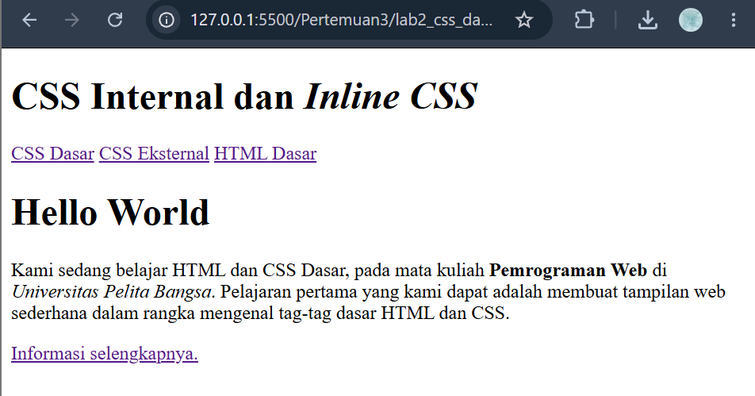

## 2. Mendeklarasikan CSS Internal

CSS internal ditulis di dalam tag `<style>` pada bagian `<head>`.

```css
body {
    font-family: 'Open Sans', sans-serif;
}
header {
    min-height: 80px;
    border-bottom: 1px solid #77CCEF;
}
h1 {
    font-size: 24px;
    color: #0F189F;
    text-align: center;
    padding: 20px 10px;
}
h1 i {
    color: #6d6a6b;
}
```

Hasil: jenis huruf halaman berubah, header memiliki garis bawah berwarna biru muda, dan judul berwarna biru tua dengan posisi rata tengah. Teks di dalam tag `<i>` pada judul berwarna abu-abu karena diatur oleh selector `h1 i`.

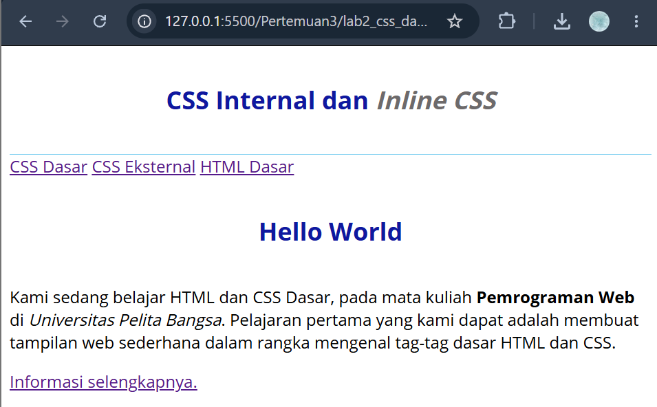

## 3. Menambahkan Inline CSS

Atribut `style` ditambahkan pada tag `<p>` di dalam `div#intro`.

```html
<p style="text-align: center; color: #ccd8e4;">
```

Hasil: paragraf tersebut menjadi rata tengah dan berwarna biru pucat. Inline CSS hanya berpengaruh pada elemen yang memuat atribut tersebut.

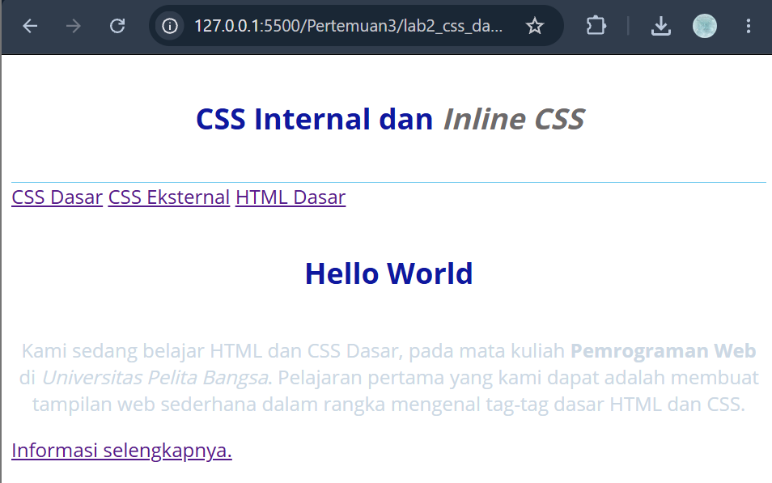

## 4. Membuat CSS Eksternal

Dibuat file `style_eksternal.css` dengan isi berikut.

```css
nav {
    background: #20A759;
    color: #fff;
    padding: 10px;
}
nav a {
    color: #fff;
    text-decoration: none;
    padding: 10px 20px;
}
nav .active,
nav a:hover {
    background: #0B6B3A;
}
```

File tersebut dihubungkan ke dokumen HTML menggunakan tag `<link>` pada bagian `<head>`.

```html
<link rel="stylesheet" href="style_eksternal.css" type="text/css">
```

Hasil: menu navigasi berlatar hijau, teks tautan berwarna putih tanpa garis bawah, dan latar tautan berubah menjadi hijau tua ketika kursor diarahkan ke tautan.

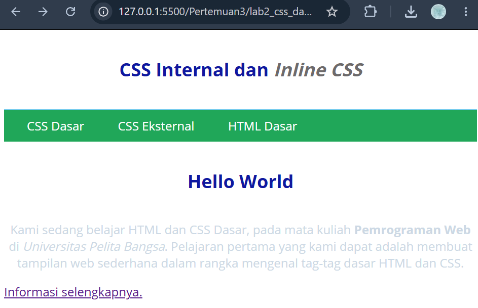

## 5. Menambahkan CSS Selector (ID dan Class)

Ditambahkan ID selector dan class selector pada file `style_eksternal.css`.

```css
/* ID Selector */
#intro {
    background: #418fb1;
    border: 1px solid #099249;
    min-height: 100px;
    padding: 10px;
}
#intro h1 {
    text-align: left;
    border: 0;
    color: #fff;
}

/* Class Selector */
.button {
    padding: 15px 20px;
    background: #bebcbd;
    color: #fff;
    display: inline-block;
    margin: 10px;
    text-decoration: none;
}
.btn-primary {
    background: #E42A42;
}
```

Hasil: elemen `#intro` berlatar biru dengan border hijau. Judul "Hello World" berwarna putih dan rata kiri, sedangkan judul pada header tetap berwarna biru dan rata tengah. Tautan "Informasi selengkapnya." tampil sebagai tombol berwarna merah.

Keterangan:
- ID selector ditulis dengan awalan `#` pada CSS dan atribut `id="intro"` pada HTML. Class selector ditulis dengan awalan `.` pada CSS dan atribut `class="button"` pada HTML.
- Tombol menggunakan dua class sekaligus (`button btn-primary`). Warna merah dari `.btn-primary` menimpa warna abu-abu dari `.button` karena bobot keduanya sama dan `.btn-primary` ditulis setelah `.button`.
- `display: inline-block` membuat tautan dapat diberi `padding` dan `margin` seperti kotak, namun tetap sejajar dengan teks di sekitarnya.

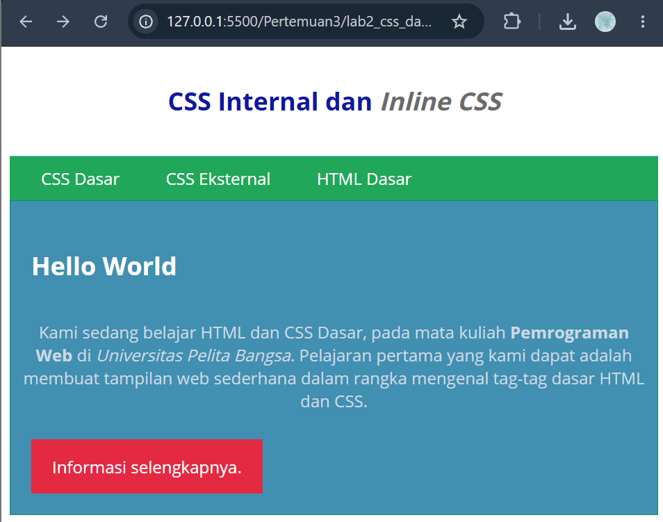

## 6. Eksperimen CSS

Dilakukan perubahan dan penambahan property serta value pada kode CSS. Setiap perubahan diikuti dengan penyegaran (refresh) halaman pada browser.

| No | File | Selector | Perubahan | Hasil |
|----|------|----------|-----------|-------|
| 1 | style_eksternal.css | `nav` | `background` diubah dari `#20A759` menjadi `#7B2CBF` | Menu navigasi berubah dari hijau menjadi ungu |
| 2 | HTML (internal) | `h1` | `font-size` diubah dari `24px` menjadi `40px` | Kedua judul menjadi lebih besar |
| 3 | style_eksternal.css | `.button` | Ditambahkan `border-radius: 60px` | Sudut tombol menjadi sangat membulat |
| 4 | style_eksternal.css | `.btn-primary:hover` | Ditambahkan `background: #e98f9b` | Tombol berwarna merah muda saat kursor berada di atasnya |
| 5 | style_eksternal.css | `#intro` | Ditambahkan `box-shadow: 4px 4px 10px rgba(0, 0, 0, 0.3)` | Kotak intro memiliki bayangan |
| 6 | style_eksternal.css | `#intro p` | Ditambahkan `font-family: Georgia, serif`, `font-size: 18px`, dan `line-height: 3` | Paragraf berfont serif, lebih besar, dengan jarak antarbaris lebih lebar |
| 7 | style_eksternal.css | `#intro p` | Ditambahkan `color: yellow` | Warna paragraf tidak berubah |

Keterangan:
- Pada percobaan 2, judul "Hello World" ikut membesar karena selector `#intro h1` tidak mengatur `font-size`, sehingga ukuran mengikuti aturan `h1`.
- Property `box-shadow` terdiri dari geser horizontal, geser vertikal, tingkat blur, dan warna. Fungsi `rgba` digunakan untuk memberi warna dengan tingkat transparansi.
- Property `line-height: 3` mengatur jarak antarbaris sebesar tiga kali ukuran huruf.
- Pada percobaan 7, aturan `color: yellow` tidak tampak hasilnya karena tag `<p>` memiliki inline CSS `color: #ccd8e4`. Inline CSS memiliki prioritas lebih tinggi daripada CSS eksternal.

Percobaan 1: perubahan warna navigasi
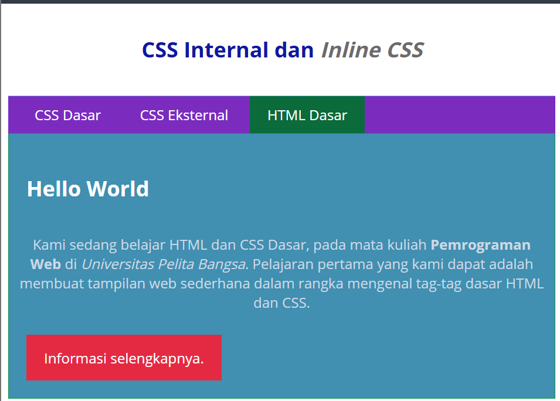

Percobaan 2: perubahan ukuran judul
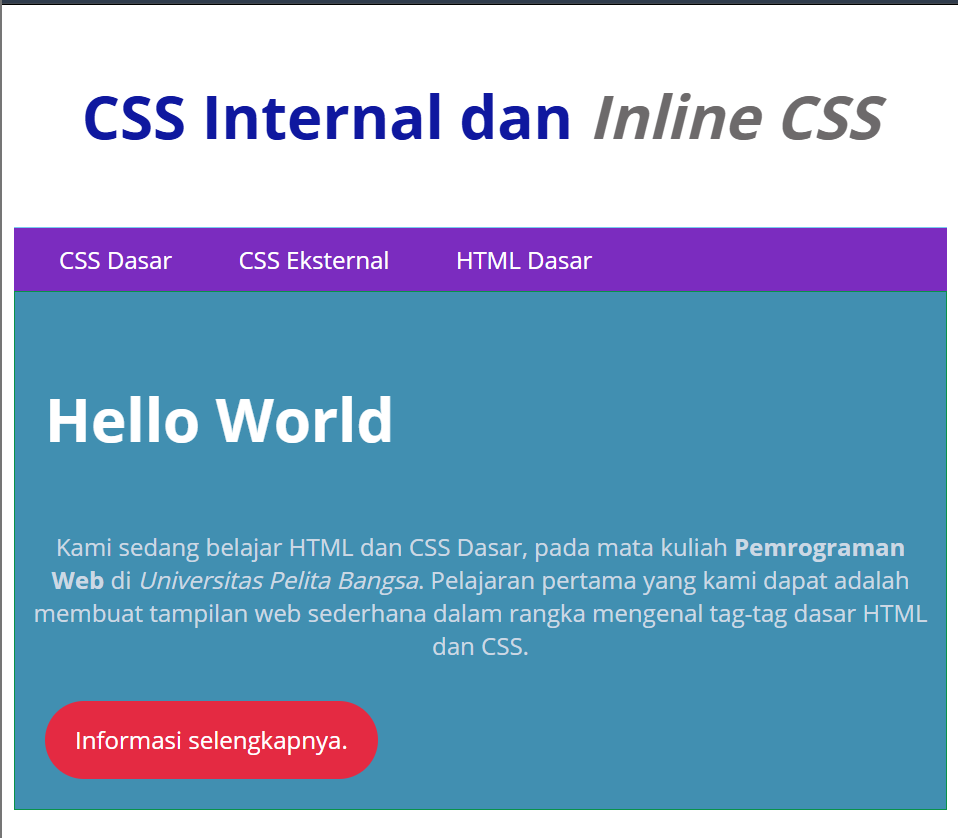

Percobaan 3: perubahan sudut tombol
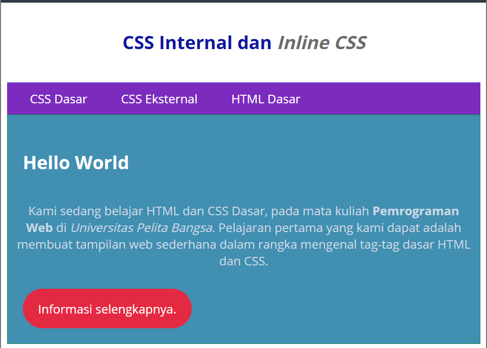

Percobaan 4: efek hover pada tombol
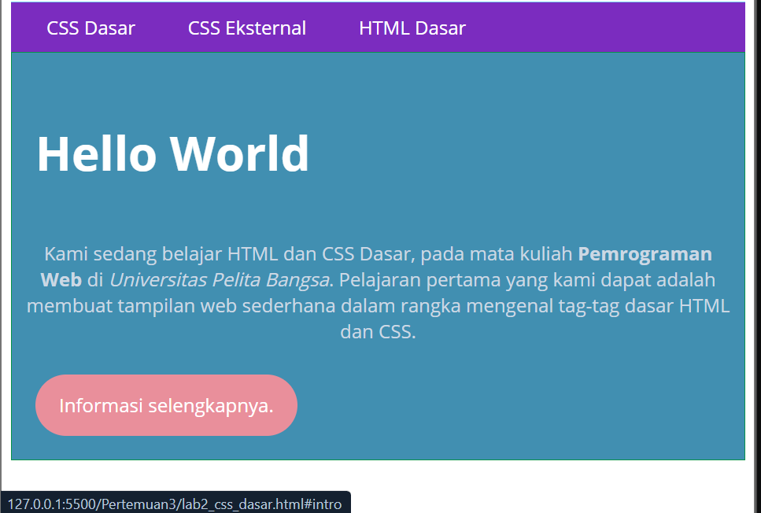

Percobaan 5: penambahan bayangan pada kotak intro
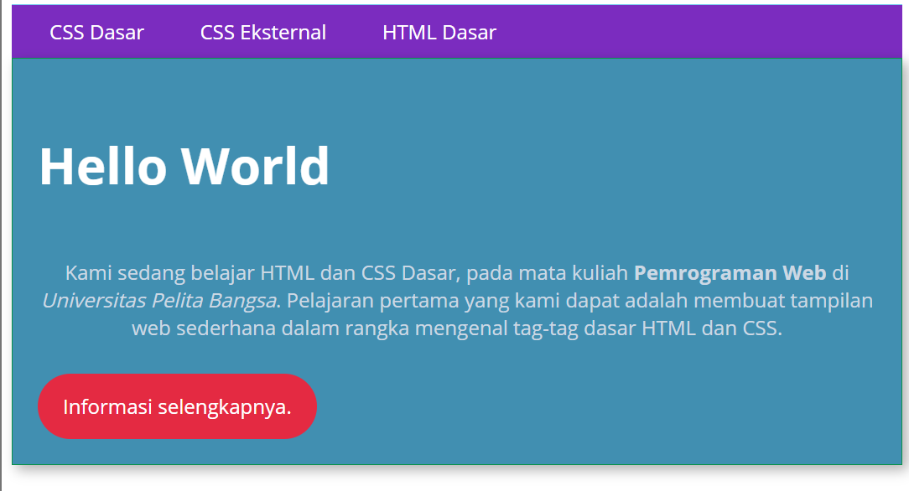

Percobaan 6: perubahan font dan jarak baris paragraf
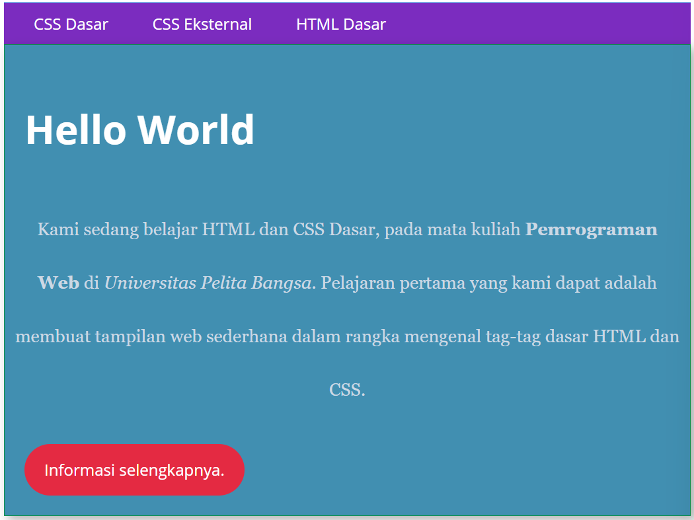

Percobaan 7: warna paragraf tidak berubah
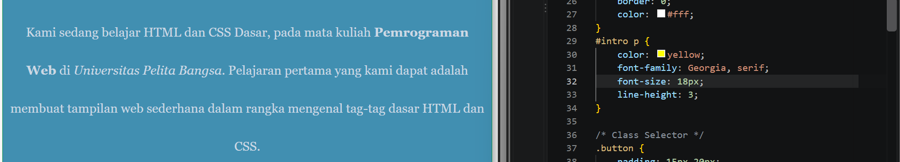

## 7. Validasi CSS

Validasi dilakukan menggunakan W3C CSS Validator (https://jigsaw.w3.org/css-validator/). CSS eksternal divalidasi melalui tab "By file upload", sedangkan CSS internal divalidasi melalui tab "By direct input".

Hasil validasi CSS eksternal:
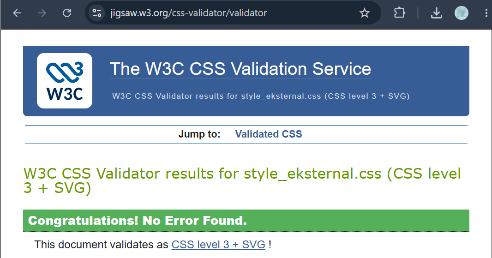

Hasil validasi CSS internal:
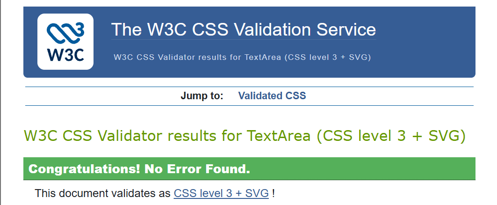

Kendala: ketika seluruh isi file HTML dimasukkan ke validator, muncul pesan kesalahan `Unknown error java.lang.Exception: import file://localhost/style_eksternal.css: Operation not permitted`.

Penyebab: kesalahan tersebut bukan berasal dari penulisan CSS. Validator berjalan pada server internet, sedangkan tag `<link>` pada HTML merujuk ke file `style_eksternal.css` yang hanya tersedia pada komputer lokal (`file://localhost`), sehingga file tidak dapat diakses oleh validator.

Penyelesaian: validasi CSS internal dilakukan dengan memasukkan isi CSS dari dalam tag `<style>` saja, tanpa tag HTML dan tanpa tag `<link>`. Setelah itu tidak ditemukan kesalahan.

---

## Pertanyaan dan Tugas

**Soal 1**
Lakukan eksperimen dengan mengubah dan menambah properti dan nilai pada kode CSS dengan mengacu pada CSS Cheat Sheet.

**Jawaban**
Eksperimen telah dilakukan dan didokumentasikan pada bagian 6 (Eksperimen CSS), berupa 7 percobaan yang mencakup perubahan warna, ukuran huruf, bentuk sudut, bayangan, jenis huruf, jarak baris, dan efek hover, lengkap dengan tangkapan layar masing-masing.

---

**Soal 2**
Apa perbedaan pendeklarasian CSS elemen `h1 {...}` dengan `#intro h1 {...}`? Berikan penjelasannya!

**Jawaban**
Selector `h1 {...}` adalah selector elemen yang berlaku untuk seluruh tag `<h1>` pada halaman. Selector `#intro h1 {...}` adalah gabungan ID selector dan selector elemen (selector turunan) yang hanya berlaku untuk tag `<h1>` yang berada di dalam elemen ber-`id="intro"`.

Pada halaman praktikum terdapat dua tag `<h1>`, yaitu judul pada `<header>` dan "Hello World" pada `div#intro`. Aturan `h1 {...}` berlaku untuk keduanya. Namun, pada "Hello World" sebagian aturan tersebut ditimpa oleh `#intro h1 {...}` (warna putih, rata kiri, tanpa border) karena selector tersebut lebih spesifik. Dengan demikian, "Hello World" tampil putih dan rata kiri, sedangkan judul pada header tetap biru dan rata tengah. Property yang tidak diatur ulang oleh `#intro h1`, seperti `font-size` dan `padding`, tetap mengikuti aturan `h1`.

| Aspek | `h1 {...}` | `#intro h1 {...}` |
|---|---|---|
| Jenis selector | Elemen | ID dan elemen (turunan) |
| Jangkauan | Seluruh `<h1>` | `<h1>` di dalam `#intro` |
| Tingkat spesifisitas | Rendah | Tinggi |

Bukti: lihat tangkapan layar pada bagian 5.


---

**Soal 3**
Apabila ada deklarasi CSS secara internal, lalu ditambahkan CSS eksternal dan inline CSS pada elemen yang sama. Deklarasi manakah yang akan ditampilkan pada browser? Berikan penjelasan dan contohnya!

**Jawaban**
Deklarasi yang ditampilkan pada browser adalah **inline CSS**.

Inline CSS ditulis langsung pada atribut `style` elemen sehingga memiliki prioritas tertinggi dibandingkan CSS internal dan eksternal. CSS internal dan eksternal memiliki prioritas yang sama apabila selector-nya sama. Pada kondisi tersebut, deklarasi yang ditulis paling akhir yang digunakan. Apabila tag `<link>` berada di atas tag `<style>`, CSS internal yang berlaku. Apabila tag `<style>` berada di atas tag `<link>`, CSS eksternal yang berlaku.

Urutan prioritas: inline > internal/eksternal (bergantung urutan penulisan).

Contoh, file `demo_soal3.css`:
```css
p { color: green; }
```

File `demo_soal3.html`:
```html
<!DOCTYPE html>
<html lang="en">
<head>
    <meta charset="UTF-8">
    <title>Demo Soal 3</title>
    <link rel="stylesheet" href="demo_soal3.css">
    <style>
        p { color: blue; }
    </style>
</head>
<body>
    <p>Paragraf 1: tanpa inline CSS, CSS internal berlaku (biru).</p>
    <p style="color: red;">Paragraf 2: dengan inline CSS, warna merah berlaku.</p>
</body>
</html>
```

Hasil: paragraf 1 berwarna biru (CSS internal mengalahkan CSS eksternal karena `<style>` ditulis setelah `<link>`), dan paragraf 2 berwarna merah (inline CSS mengalahkan keduanya).

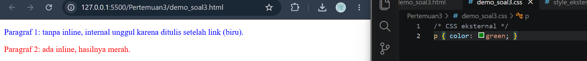

Bukti tambahan pada halaman utama: pada percobaan 7, CSS eksternal `#intro p { color: yellow; }` tidak mengubah warna paragraf karena kalah oleh inline CSS `color: #ccd8e4`.

---

**Soal 4**
Pada sebuah elemen HTML terdapat ID dan Class, apabila masing-masing selector tersebut terdapat deklarasi CSS, maka deklarasi manakah yang akan ditampilkan pada browser? Berikan penjelasan dan contohnya! (`<p id="paragraf-1" class="textparagraf">`)

**Jawaban**
Deklarasi yang ditampilkan pada browser adalah deklarasi dari **ID selector**.

ID selector memiliki prioritas (spesifisitas) lebih tinggi daripada class selector. Apabila keduanya mengatur property yang sama pada elemen yang sama, aturan ID yang digunakan, tanpa bergantung pada urutan penulisan. Property yang tidak diatur oleh ID tetap mengikuti aturan class.

Contoh, file `demo_soal4.html`:
```html
<!DOCTYPE html>
<html lang="en">
<head>
    <meta charset="UTF-8">
    <title>Demo Soal 4</title>
    <style>
        .textparagraf { color: blue; }
        #paragraf-1   { color: red; }
    </style>
</head>
<body>
    <p id="paragraf-1" class="textparagraf">Paragraf ini berwarna merah karena ID mengalahkan class.</p>
    <p class="textparagraf">Paragraf ini berwarna biru karena hanya memakai class.</p>
</body>
</html>
```

Hasil: paragraf pertama (ID dan class) berwarna merah, sedangkan paragraf kedua (hanya class) berwarna biru.

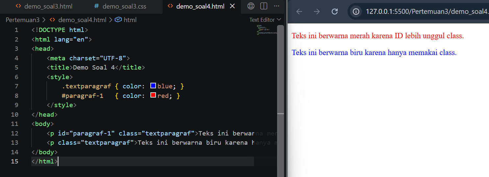

---

## Kesimpulan

CSS dapat ditulis secara internal, eksternal, dan inline, dengan CSS eksternal sebagai cara yang paling efisien untuk banyak halaman. Selector elemen berlaku untuk seluruh tag sejenis, class dapat digunakan pada banyak elemen, dan ID bersifat unik untuk satu elemen. Apabila terjadi bentrok aturan, prioritas ditentukan oleh spesifisitas selector: inline lebih tinggi daripada ID, ID lebih tinggi daripada class, dan class lebih tinggi daripada selector elemen. Pada tingkat prioritas yang sama, aturan yang ditulis paling akhir yang berlaku.
